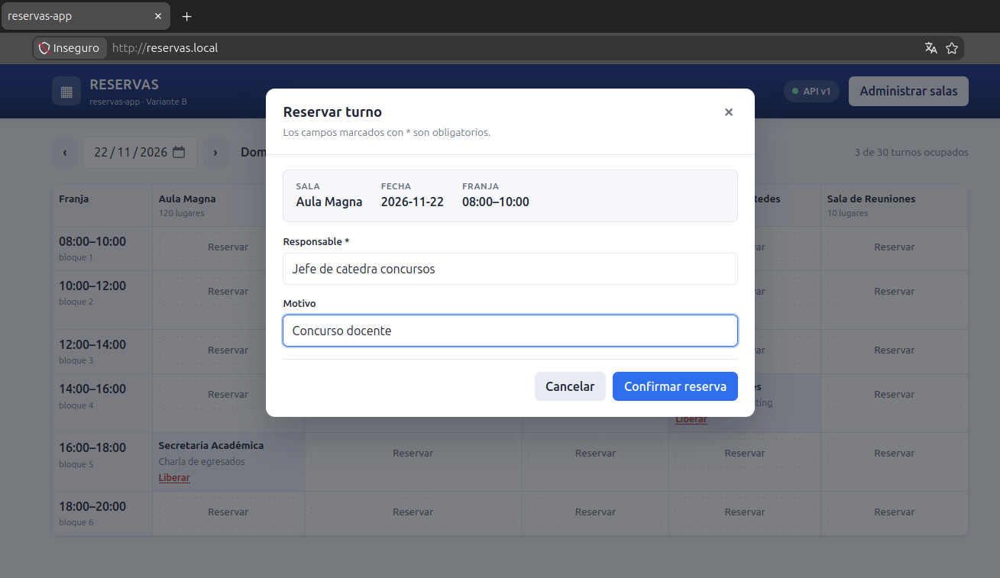

# Informe de Despliegue y Funcionamiento — `reservas-app` (TP 1 a TP 8)

## Resumen de Evolución por Etapas (TP 1 – TP 8)

* **TP 1 (Contenedores base y ciclo de vida):** Ejecución manual de `mysql:8.4`, diagnóstico de fallo por ausencia de `MYSQL_ROOT_PASSWORD`, auditoría de variables en texto plano con `docker inspect` y comprobación de pérdida de datos sin volumen al recrear el contenedor.
* **TP 2 (Imágenes multi-etapa y Docker Hub):** Construcción multi-etapa en `backend/Dockerfile` (`node:20-alpine`, `npm ci --omit=dev`, usuario no privilegiado `node`, `ARG APP_VERSION`) y `frontend/Dockerfile` (`nginxinc/nginx-unprivileged:1.27-alpine`, usuario `nginx`, ausencia de Node.js en producción). Publicación de `luisv3k/reservas-api:v1`, `reservas-api:v2` y `reservas-frontend:v1`.
* **TP 3 (Redes y volúmenes en Docker):** Creación de red `reservas-net` y volumen `reservas-db-data`, comprobación de fallo DNS al arrancar el frontend fuera de red, verificación del proxy `/api/` y persistencia tras eliminar el contenedor de MySQL.
* **TP 4 (Docker Compose):** Orquestación declarativa en `docker-compose.yml` con healthchecks (`condition: service_healthy`), principio de mínimo privilegio (`cap_drop: [ALL]`) y externalización de variables mediante `.env` (ignorado en Git) y `.env.example`.
* **TP 5 y TP 6 (Pods, Deployments, Services y Concurrencia):** Diagnóstico de falta de DNS entre Pods sueltos, migración a Deployments y Services, Rolling Update/Rollback de versión y prueba de concurrencia con 3 réplicas de API.
* **TP 7 (Configuración externalizada, Persistencia e Ingress):** Separación de parámetros en `reservas-api-config`, `reservas-frontend-config` y `reservas-db-secret`, montaje persistente con `subPath: mysql` sobre `reservas-db-pvc` y exposición unificada mediante `reservas-app-ingress` (`reservas.local`).
* **TP 8 (Autoescalado HPA y Empaquetado Helm):** Incorporación de `resources.requests` en `reservas-api`, creación de `reservas-api-hpa` (2 a 6 réplicas al 50% de CPU) y empaquetado parametrizado de los 12 objetos en el Chart `reservas-app/`.

---

## Evidencias Obligatorias del Despliegue

### 1. Aplicación respondiendo a través del Ingress y persistencia de reserva
Se configuró `reservas.local` apuntando a la `EXTERNAL-IP` del Ingress Controller. La ruta `/reservas` devuelve `200 OK` con `index.html` debido a `try_files` de la SPA (falso positivo), mientras que `/api/reservas` atraviesa el proxy de Nginx y devuelve el JSON real de la API.

* **Captura en navegador (`http://reservas.local` con reserva creada):** 
* **Registro de Secret sin cifrar, respuesta JSON y persistencia tras recrear Pod DB:** Ver [`informe/01-tp7-validaciones.txt`](informe/01-tp7-validaciones.txt).

### 2. Autoescalado Horizontal (`kubectl get hpa -w`) bajo carga real
Con `resources.requests.cpu: 100m` declarado en `deploy-reservas-api`, se generó tráfico continuo mediante Pods `busybox` hacia `http://reservas-api:3000/reservas`. Al superar el umbral del 50% de CPU, el HPA escaló de 2 a 6 réplicas y, tras detener la carga y cumplirse la ventana de estabilización, redujo nuevamente las réplicas a 2.

* **Registro completo de subida y bajada:** Ver [`informe/02-hpa-escalado.txt`](informe/02-hpa-escalado.txt).

### 3. Ciclo de vida completo de la release con Helm (`upgrade` y `rollback`)
Se instaló la release `reservas` en el namespace `reservas-app`, se actualizó la API a `v2` mediante `helm upgrade --set api.image.tag=v2` (sin alterar `reservas-frontend:v1`, ya que poseen ciclos de vida independientes) y se revirtió a la revisión 1 con `helm rollback reservas 1`.

* **Salida de `helm history` y estado de los 12 objetos:** Ver [`informe/03-helm-history.txt`](informe/03-helm-history.txt).

### 4. Verificación de parametrización real en `values.yaml` (`helm template`)
Se renderizó el chart dos veces modificando valores mediante `--set` (`api.image.tag=v2` y `api.hpa.maxReplicas=8`) y se compararon ambas salidas con `diff -u`, demostrando que las plantillas generan los 12 objetos exactos y aplican los cambios de configuración.

* **Salida de `helm template` y `diff -u`:** Ver [`informe/04-helm-template-diff.txt`](informe/04-helm-template-diff.txt).

### 5. Prueba de concurrencia con 3 réplicas de la API (Entrega 6)
Se escaló `reservas-api` a 3 réplicas y se enviaron 30 peticiones `POST` simultáneas para la misma sala, fecha y franja horaria. Solo 1 petición obtuvo `201 Created` y las 29 restantes recibieron `409 Conflict`, confirmando que la restricción `UNIQUE (sala_id, fecha, franja)` en MySQL garantiza la integridad.

* **Registro de peticiones concurrentes y consulta SQL:** Ver [`informe/05-concurrencia.txt`](informe/05-concurrencia.txt).
